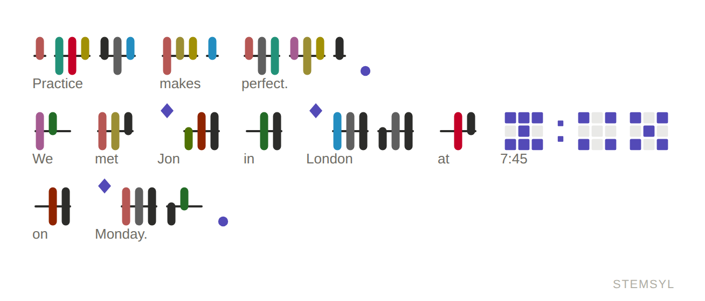
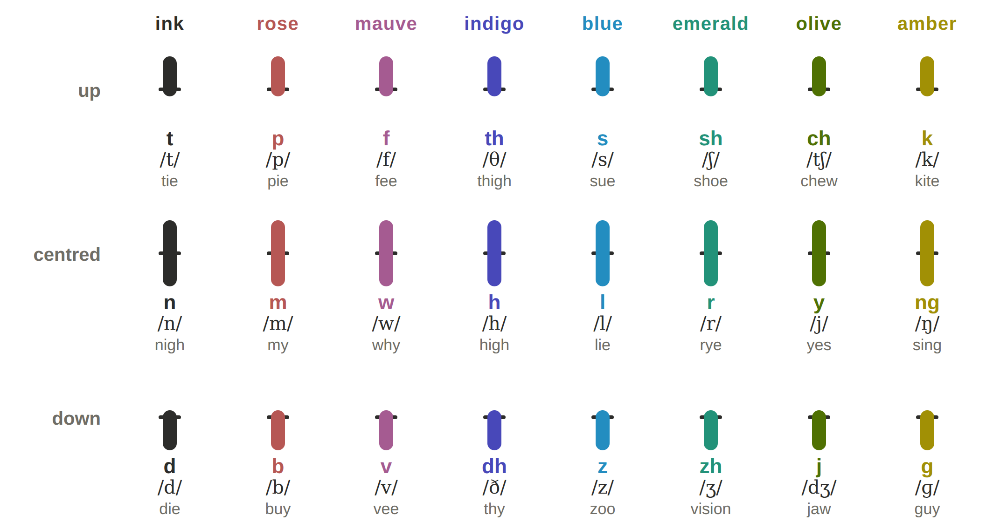

# Stemsyl

**A colour-stem phonetic script for English, with keyboards for phones and watches.**



Stemsyl writes English by its sounds. Each syllable is a short stem with up to three ticks on it: the consonant before the vowel, the vowel, and the consonant after it. A tick sits above the stem, across it, or below it, and has a colour. Its position and colour name exactly one of English's 38 sounds.

Because every sound is a position and then a colour, Stemsyl can be typed with two taps on a 3 × 3 grid of keys. That is small enough for a watch.

This repository holds three things:

- the complete **specification** of the script and its keyboards
- three free **apps**: a keyboard for phones and computers, a watch keyboard, and a reading trainer
- a **pronouncing word list** of 271,173 English words

## Try it

The apps are single web pages. They work offline, and keep your notes on your own device.

| App | File | What it is |
|---|---|---|
| Keyboard | [`docs/stemsyl-keyboard.html`](docs/stemsyl-keyboard.html) | Notes in Stemsyl. It has two layouts: **Keys**, with a key for every sound, and **3 × 3**, two taps per sound. |
| Watch keyboard | [`docs/stemsyl-keyboard-watch.html`](docs/stemsyl-keyboard-watch.html) | The 3 × 3 keyboard and a whole editor on a 208 × 248-point Apple Watch-size screen. Hold the middle key of an edge for numbers, punctuation, the options or the cursor. Hold delete to clear the text. |
| Trainer | [`docs/stemsyl-trainer.html`](docs/stemsyl-trainer.html) | Reading practice, with spoken sounds. |

To use an app, download its file and open it in any browser. If this repository has its website turned on (see [PUBLISHING.md](PUBLISHING.md)), the apps and the specification are also on that website.

## Read the specification

- [**SPECIFICATION.md**](SPECIFICATION.md): the script, the keyboards, the word list, variations and related work.
- [`docs/stemsyl.html`](docs/stemsyl.html): the same as a web page.
- [`docs/stemsyl-specification.pdf`](docs/stemsyl-specification.pdf): the same as a PDF, for printing and for publication as prior art.



## What's in this repository

| Folder or file | What it holds |
|---|---|
| `SPECIFICATION.md` | the specification (public domain, CC0 1.0) |
| `docs/` | the website: the three apps, the specification as a web page and a PDF, and its figures |
| `data/` | the word list, `stemsyl-words.tsv` ([format](data/README.md)) |
| `tools/` | the scripts that build the apps, the figures and the PDF, and that made the word list ([how](tools/README.md)) |
| `tests/` | browser tests of the apps at phone and watch sizes ([how](tests/README.md)) |
| `LICENSE`, `LICENSES/` | the licence texts |
| `NOTICE.md` | the word list's sources and their notices |
| `AUTHORS.md`, `CITATION.cff` | who made Stemsyl, and how to cite it |
| `PUBLISHING.md` | a checklist for putting all of this online and on the record as prior art |

## Licences

| Part | Licence | You may |
|---|---|---|
| The Stemsyl writing system, its glyph designs, and the specification (`SPECIFICATION.md`, figures 1 to 6) | [CC0 1.0](LICENSES/CC0-1.0.txt): public domain | use it for anything, with no conditions |
| The apps, build tools and tests | [GPL-3.0-or-later](LICENSE) | use, study, change and share them, keeping them free under the same licence |
| The word list (`data/stemsyl-words.tsv`, also inside the apps) | [CC BY-SA 4.0](LICENSES/CC-BY-SA-4.0.txt) | use and change it, crediting its sources and sharing changes alike |

The word list is built from the CMU Pronouncing Dictionary, the English Speller Database (SCOWL), Hermit Dave's FrequencyWords, eSpeak NG, Kyubyong Park and Jongseok Kim's g2p model, and the LDNOOBW list. [NOTICE.md](NOTICE.md) gives their notices.

Stemsyl is published so that no one can patent it. The specification is a dated public disclosure, and everything in it is prior art.

## Build and test

You need Python 3.9 or later, and the Python packages in [`tools/requirements.txt`](tools/requirements.txt): Playwright with its Chromium browser, `markdown` and `pypdf`.

```sh
pip install -r tools/requirements.txt
python -m playwright install chromium
python3 tools/rebuild.py            # the apps, the figures, the web page and the PDF (about 30 seconds)
python3 tests/run.py                # every test (about 3 minutes)
python3 tools/rebuild.py --test     # both
```

See [tools/README.md](tools/README.md) for how the apps are built from their sources, and how to change them.

## Cite

> Larson, Phillip Bryan. *Stemsyl: a colour-stem phonetic script for English, with keyboards for phones and watches.* Specification, version 1.0, 28 September 2026.

[CITATION.cff](CITATION.cff) has the same in a form GitHub and Zenodo read.

## Authors

Stemsyl was created by **Phillip Bryan Larson**. The software, figures and documentation were written with the help of Claude, an AI model made by Anthropic, working from his designs and instructions. See [AUTHORS.md](AUTHORS.md).

*Apple Watch is a trademark of Apple Inc. Stemsyl is not affiliated with or endorsed by Apple.*
