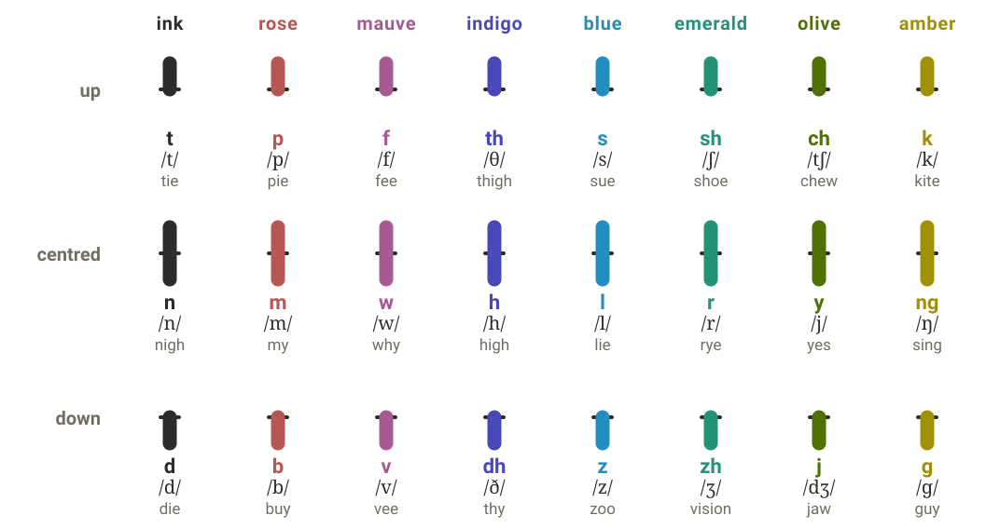
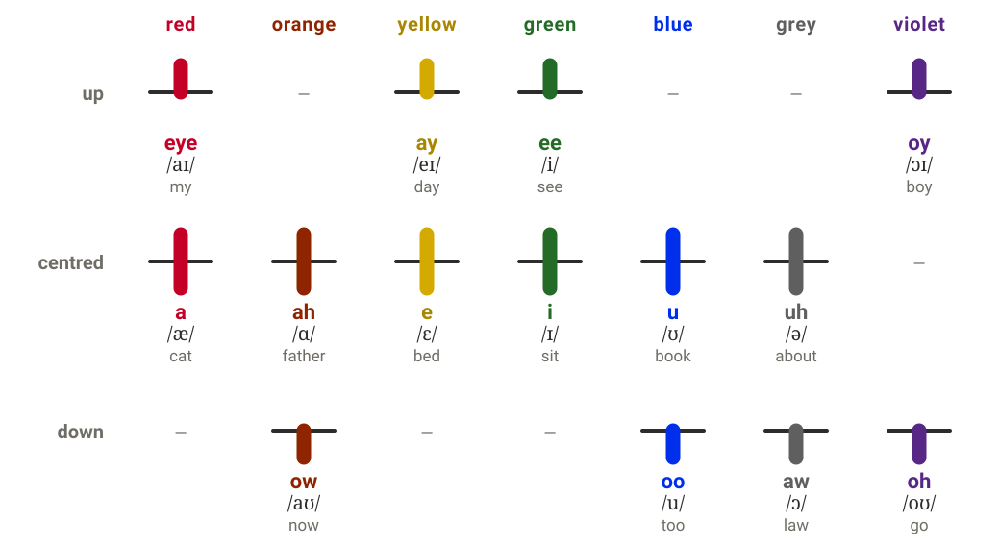
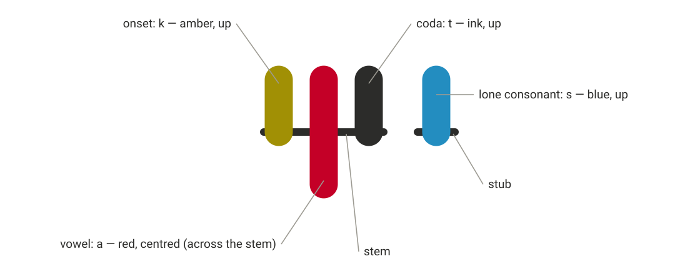
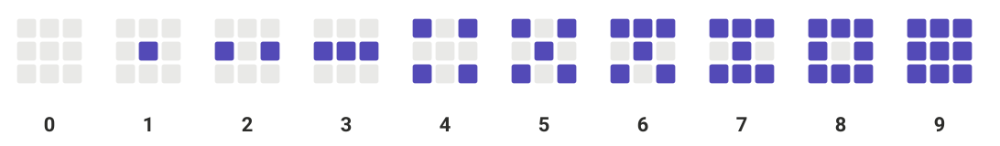
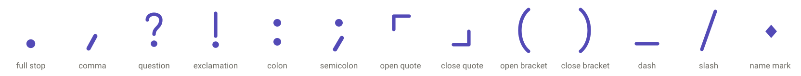
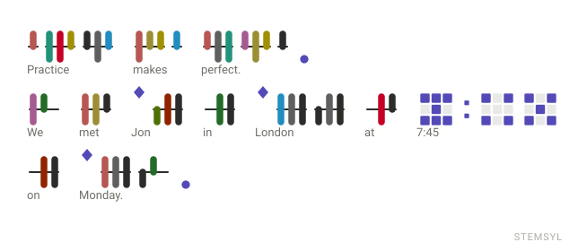
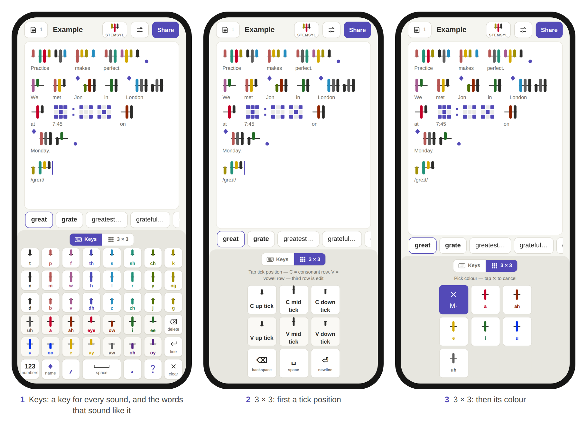
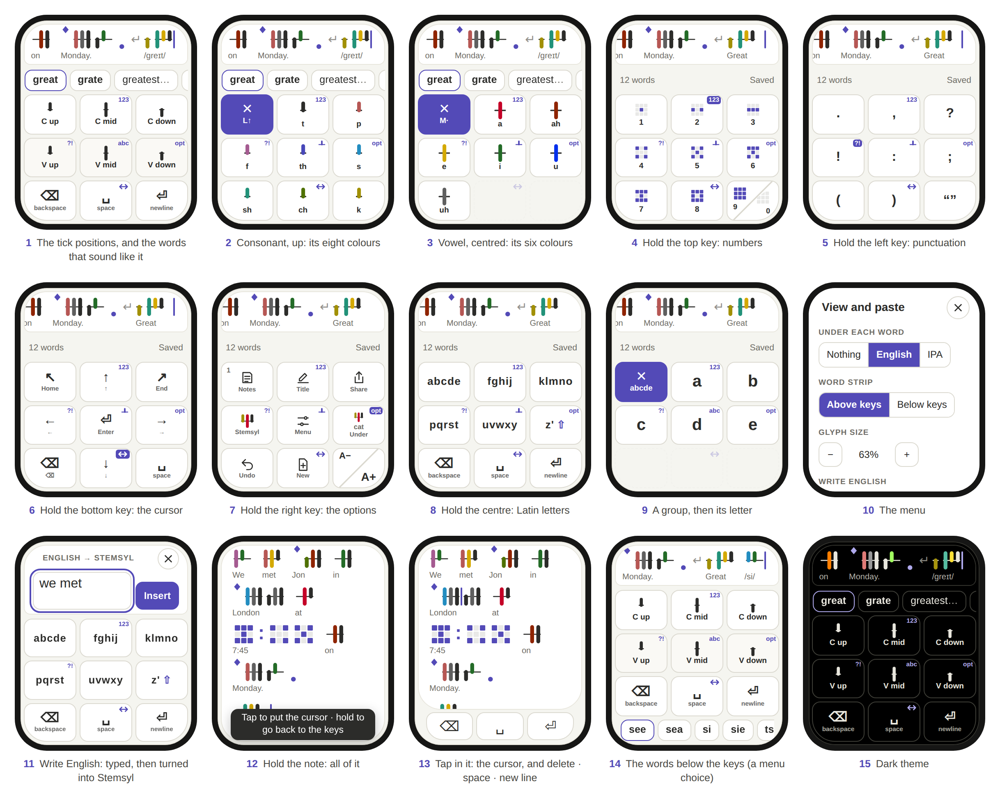

# Stemsyl

**A colour-stem phonetic script for English, with keyboards for phones and watches**

Specification, version 1.0 · 28 September 2026 · Phillip Bryan Larson

This specification and the Stemsyl writing system are dedicated to the public domain under [CC0 1.0](LICENSES/CC0-1.0.txt). Anyone may use, copy, change, teach and build on them, for any purpose, without asking.

## Abstract

Stemsyl is a phonetic writing system for English. Each syllable is drawn as a short horizontal stem carrying up to three vertical ticks: the consonant before the vowel, the vowel, and the consonant after it. A tick can be above the stem, centred across it, or below it. Its position together with its colour names exactly one sound. The 24 consonants form eight colour families of three, and the 14 vowels use seven colours in up to three positions each. A consonant that belongs to no vowel stands on a short stub of its own. Numerals are dice-like patterns on a 3 × 3 grid, and a diamond marks names.

Because every sound is a choice of position and then of colour, Stemsyl can be typed with two taps on a 3 × 3 grid of keys. This document specifies the script and several ways of typing it:

- a keyboard with a key for every sound
- the two-tap 3 × 3 keyboard
- a watch keyboard that fits a whole editor into 208 × 248 points and reaches its other pages of keys by holding the middle key of an edge
- a 3 × 3 keyboard for Latin letters
- a rule for showing the English word under each written word when exactly one English word has those sounds

It also documents the 271,173-word pronouncing list that the reference apps use, and many variations. It is published so that all of this is prior art, free for anyone to use.

## Contents

1. [About this document](#1-about-this-document)
2. [The sounds](#2-the-sounds)
3. [The glyphs](#3-the-glyphs)
4. [Writing English in Stemsyl](#4-writing-english-in-stemsyl)
5. [Keyboards](#5-keyboards)
6. [The word list](#6-the-word-list)
7. [Variations and extensions](#7-variations-and-extensions)
8. [Related work](#8-related-work)
9. [Reference implementation](#9-reference-implementation)
10. [Licence, authorship and citation](#10-licence-authorship-and-citation)
11. [Appendix: tables](#11-appendix-tables)

## 1. About this document

### 1.1 Purpose

This is a defensive publication. It describes the Stemsyl writing system, the methods of typing it and the software that implements them in enough detail for a person skilled in the field to reproduce them. The date on it establishes all of this as prior art, so no one can later patent these ideas and lock them up. The author claims no patent on any of it and dedicates the writing system and this text to the public domain.

### 1.2 What it covers

- **The script** (sections 2 and 3): its sounds, the shape and colour of every glyph, how sounds group into syllables, numerals, punctuation, the name mark, and captions in English or IPA.
- **Transcription** (section 4): turning English into Stemsyl with a pronouncing word list, and deciding which English word a written word stands for.
- **Keyboards** (section 5): the key-per-sound keyboard, the two-tap 3 × 3 keyboard, the watch keyboard with its hold-to-switch keys, display mode and edit bar, the Latin-letter 3 × 3 keyboard, word suggestions, physical keyboards and paste.
- **The word list** (section 6): its sources, how its pronunciations were made, and its file format.
- **Variations** (section 7): other accents and languages, other ways to draw and colour the glyphs, and other devices and gestures for the same input methods.

### 1.3 Reference implementation

Three single-file web apps implement everything described here. They run in any modern browser, offline. The keyboards keep their notes on the device. The apps are released as free software under GPL-3.0-or-later (section 10).

- **Stemsyl Keyboard** (`docs/stemsyl-keyboard.html`): a note editor for phones, tablets and computers, with two keyboard layouts, Keys and 3 × 3.
- **Stemsyl Keyboard for Watch** (`docs/stemsyl-keyboard-watch.html`): the 3 × 3 keyboard and a complete editor in a 208 × 248-point screen.
- **Stemsyl Trainer** (`docs/stemsyl-trainer.html`): reading practice with spoken sounds.

Where this document gives a size, a time or a colour, it is the value the reference apps use. Other values that keep the same relationships are equally Stemsyl.

### 1.4 Notation

Sounds are given in IPA between slashes, for example /θ/. Each sound also has a one-character **sound letter**, used in the data files and the apps' code, and a short **name** shown on the keys, for example `T` and *th*. Section 11 lists all three for every sound. Glyph measurements are in **units**: a glyph is 64 units tall, and y grows downward.

## 2. The sounds

Stemsyl writes the sounds of General American English, not its spellings: 24 consonants and 14 vowels. Stress is not written.

### 2.1 Consonants

The consonants form eight families of three. The family decides the colour. The member decides the position:

- **up**: voiceless
- **centred**: the family's sonorant, or *h*
- **down**: voiced

The families are loosely ordered around the colour wheel from the lips to the back of the mouth, so that a misread colour tends to land on a related sound. The first family, the alveolar *t n d*, is written in plain ink because it is the most frequent.

| Family | Up | Centred | Down |
|---|---|---|---|
| **ink** | t /t/ *tie* | n /n/ *nigh* | d /d/ *die* |
| **rose** | p /p/ *pie* | m /m/ *my* | b /b/ *buy* |
| **mauve** | f /f/ *fee* | w /w/ *why* | v /v/ *vee* |
| **indigo** | th /θ/ *thigh* | h /h/ *high* | dh /ð/ *thy* |
| **blue** | s /s/ *sue* | l /l/ *lie* | z /z/ *zoo* |
| **emerald** | sh /ʃ/ *shoe* | r /r/ *rye* | zh /ʒ/ *vision* |
| **olive** | ch /tʃ/ *chew* | y /j/ *yes* | j /dʒ/ *jaw* |
| **amber** | k /k/ *kite* | ng /ŋ/ *sing* | g /ɡ/ *guy* |

*Figure 1. The consonants, each drawn as a lone consonant on its stub (section 3.3).*

### 2.2 Vowels

Each vowel colour holds a plain vowel and a vowel that starts near it. The position says how the vowel ends:

- **centred**: the plain vowel
- **up**: glides toward *ee*
- **down**: glides toward *oo*

*aw* is the one exception: it does not glide, but it is written down, in grey, beside the plain *uh*.

| Colour | Centred | Up | Down |
|---|---|---|---|
| **red** | a /æ/ *cat* | eye /aɪ/ *my* | — |
| **orange** | ah /ɑ/ *father* | — | ow /aʊ/ *now* |
| **yellow** | e /ɛ/ *bed* | ay /eɪ/ *day* | — |
| **green** | i /ɪ/ *sit* | ee /i/ *see* | — |
| **blue** | u /ʊ/ *book* | — | oo /u/ *too* |
| **grey** | uh /ə/ *about* | — | aw /ɔ/ *law* |
| **violet** | — | oy /ɔɪ/ *boy* | oh /oʊ/ *go* |

*Figure 2. The vowels, each drawn as a syllable with only a vowel tick.*

### 2.3 Conventions

The reference word list writes General American with these conventions:

- **One weak vowel.** The vowel of *cup* and the weak vowel of *about* are both *uh* /ə/.
- **LOT is PALM.** *hot* and *father* have the same vowel, *ah* /ɑ/. *aw* /ɔ/ stays separate (*caught*, *law*).
- **R-coloured vowels are a vowel plus r.** *bird* is b-uh-r-d, *car* is k-ah-r, *hair* is h-e-r, *near* is n-i-r.
- **NORTH and FORCE** are *oh* + r (*north*, *four*), except after w, where they are *ah* + r (*war*, *quarter*).
- **Unstressed for-** in *forget*, *forgive* and similar words is *uh* + r.
- **Syllabic consonants** are *uh* plus the consonant: *bottle* is b-ah-t-uh-l.
- **Flaps** are written as the t or d the spelling shows: *water* is w-aw-t-uh-r.

A word may have up to three pronunciations in the list, for example *the* as both *dh-uh* and *dh-ee*. Writers can use whichever they say.

## 3. The glyphs

### 3.1 The syllable

A syllable glyph is 42 units wide. It has three parts:

- **The stem**: a horizontal line from x = 5 to x = 37 at y = 32, 2 units thick with round ends, always drawn in the ink colour.
- **Three tick slots**: at x = 9 for the **onset** (the consonant before the vowel), x = 21 for the **vowel** and x = 33 for the **coda** (the consonant after it).
- **The ticks**: vertical strokes 7.5 units wide with round caps. A tick's colour and position name its sound (section 2). Its position sets its extent, where L = 14 is the tick length:

| Position | From | To | Length |
|---|---|---|---|
| up | y = 18 | y = 32 (the stem) | L |
| centred | y = 18 | y = 46 | 2L, crossing the stem |
| down | y = 32 (the stem) | y = 46 | L |

Every syllable has a vowel tick. The onset and coda slots may be empty. The stem still spans all three slots, so an empty slot shows as bare stem, and a reader can always tell which slot a tick is in. The glyphs are displayed in the band y = 8 to 56.

*Figure 3. Anatomy of* cats *(k-a-t-s): one syllable, then a lone consonant.*

### 3.2 Why each shape was chosen

- The centred tick is twice as long as the others and crosses the stem, so it reads as centred even at small sizes.
- Up, centred and down lie on the same three rows as the keys of the 3 × 3 keyboard and of the key grid (section 5). A writer who learns where a tick sits has also learned where its key is.
- Slots are fixed. The order of the ticks, not their spacing, says which consonant comes before the vowel and which after, so there is no ambiguity even in a word like *cats*.

### 3.3 The lone consonant

A consonant that is neither an onset nor a coda stands alone. Its glyph is 18 units wide: a stub from x = 4 to x = 14 at y = 32, and a tick at x = 9 in the consonant's colour and position. Lone consonants carry clusters such as the *s* and *t* of *street* and the *k th s* of *strengths*.

### 3.4 Syllables from sounds

A word is a run of sounds. Stemsyl groups them into glyphs by a fixed rule, so writers never mark syllables:

1. Each vowel takes the consonant just before it as its **onset**, unless that consonant is *ng*.
2. Each vowel then takes the consonant just after it as its **coda**, if that consonant did not become the next vowel's onset and is not *h*, *y* or *w*.
3. Every consonant left over stands alone (section 3.3).
4. The glyphs follow in the order of their sounds. The glyphs of one word touch; their widths include the gaps between them.

| Word | Sounds | Glyphs |
|---|---|---|
| cats | k a t s | [k·a·t] s |
| street | s t r ee t | s t [r·ee·t] |
| happy | h a p ee | [h·a] [p·ee] |
| London | l uh n d uh n | [l·uh·n] [d·uh·n] |
| every | e v r ee | [e·v] [r·ee] |
| ahead | uh h e d | [uh] [h·e·d] |
| singer | s i ng uh r | [s·i·ng] [uh·r] |
| extra | e k s t r uh | [e·k] s t [r·uh] |
| world | w uh r l d | [w·uh·r] l d |
| strengths | s t r e ng k th s | s t [r·e·ng] k th s |

*Square brackets hold one syllable glyph, as onset · vowel · coda. Letters outside brackets are lone consonants.*

### 3.5 Words, spaces and lines

Stemsyl is written left to right, in lines from top to bottom. Words are separated by a space 16 units wide, and a line break starts a new line. Punctuation, numerals and the name mark sit on the same line as the words, in the order they are read.

### 3.6 The name mark

A filled diamond marks a name, where English would use a capital letter: ◆ before *Jon*, ◆ before *London*. It is 22 units wide, with corners at (11, 6), (17, 13), (11, 20) and (5, 13), and it sits above the stem line, before the first glyph of the name. Sentence starts need no mark, because they are clear from the full stop before them. It is drawn in the **mark colour**, which is also used for numerals and punctuation (section 3.9).

### 3.7 Numerals

A numeral is a 3 × 3 grid of square dots laid out like the pips on dice: a digit lights as many dots as its value. Unlit dots stay faintly visible, so a reader can count instead of remembering. The numerals are not the author's design. They are borrowed from the digits of an "Intuitive Clock" that the author saw shared on Reddit, and who first designed them is not known.

| Digit | Lit dots (row, column; 1 is top or left) |
|---|---|
| 0 | none: the empty grid |
| 1 | centre (2,2) |
| 2 | the ends of the middle row (2,1), (2,3) |
| 3 | the middle row |
| 4 | the four corners |
| 5 | the corners and the centre |
| 6 | 5, plus the top middle (1,2) |
| 7 | 6, plus the bottom middle (3,2) |
| 8 | the ring: every dot but the centre |
| 9 | all nine |

A numeral is 48 units wide. Its dots are 10.4-unit squares with corners rounded by 12% of their size, 2.08 units apart. The grid is centred on the stem line, so the middle row, which holds 1, 2 and 3, runs along the line of the words. Lit dots are in the mark colour, and unlit ones in the frame colour (#9C9A92, or #8B8A83 in the dark theme) at 22% opacity.

Between two digits, three characters take the numerals' own form:

- A **colon** (as in 7:45) is two small squares, one above the other.
- A **full stop** (a decimal point) is one small square at the foot of the grid.
- A **comma** (a thousands separator) is a thin gap.

The small squares are half a dot wide.

*Figure 4. The numerals.*

### 3.8 Punctuation

Stemsyl uses twelve punctuation marks, drawn in the mark colour with strokes 3.6 units wide and round ends. Each is 30 units wide.

| Mark | Glyph |
|---|---|
| full stop . | a dot of radius 4.6 near the foot of the line (y = 46) |
| comma , | a short stroke slanting down to the left, below the stem |
| question ? | a hook over a dot |
| exclamation ! | an upright stroke over a dot |
| colon : | two dots, above and below the stem |
| semicolon ; | a dot above the stem and a comma stroke below |
| open quote “ | an upper-left corner ⌜ |
| close quote ” | a lower-right corner ⌟ |
| open bracket ( | a curve open to the right |
| close bracket ) | a curve open to the left |
| dash – | a low horizontal stroke |
| slash / | a long stroke slanting up to the right |

*Figure 5. Punctuation, and the name mark.*

### 3.9 Colour

| Name | Light theme | Dark theme | Used for |
|---|---|---|---|
| ink | #2C2C2A | #E8E6DD | the t n d family, and every stem and stub |
| rose | #B65754 | #E07B77 | p m b |
| mauve | #A55B91 | #D487BE | f w v |
| indigo | #4848B9 | #9084FF | th h dh |
| blue (consonant) | #238DC0 | #6FC6FC | s l z |
| emerald | #229279 | #55BCA1 | sh r zh |
| olive | #4F7103 | #BCDD73 | ch y j |
| amber | #A19005 | #A6940E | k ng g |
| red | #C40027 | #C34A55 | a, eye |
| orange | #8F2400 | #FF7F00 | ah, ow |
| yellow | #D4A900 | #FFE135 | e, ay |
| green | #236B27 | #A1FD60 | i, ee |
| blue (vowel) | #002FEC | #5081C8 | u, oo |
| grey | #5F5F5F | #999999 | uh, aw |
| violet | #582684 | #9826EA | oh, oy |
| mark | #534AB7 | #AFA9EC | numerals, punctuation, the name mark |

The consonant colours were chosen to stay distinct for normal vision and for red-weak and green-weak vision. The vowel colours were then tuned to stay distinct from the consonant families under normal, protan and deutan vision. Colour is never the only cue:

- A tick's slot says whether it is a consonant or a vowel.
- Its position can be read without colour, and narrows a consonant to one of eight sounds and a vowel to one of four or six.
- English or IPA can be shown under every word (section 3.10).

The light theme is ink on white; the dark theme is light ink on black.

### 3.10 Captions: English or IPA under each word

A writer can show, under each written word, nothing, its English spelling, or its sounds in IPA. The whole note can also be shown as English or as IPA instead of Stemsyl.

The English under a word is chosen by this rule:

1. If the writer picked the word from the suggestion strip, or typed it in English, its spelling is kept with its sounds and shown.
2. Otherwise, if exactly one English word has exactly these sounds, that word is shown. Unless the word follows the name mark, only everyday dictionary words count here, so rare words and surnames that happen to share the sounds (for *boy*: *Boye*; for *cat*: *Catt*) don't stop a common word from being shown. After the name mark, names count too, so *Jon* and *John* stay undecided.
3. Two short sounds are always the same word: *eye* on its own is *I*, and *uh* on its own is *a*.
4. Otherwise (homophones such as *see* and *sea*, or sounds that make no word) the sounds are shown in IPA between slashes, for example /si/, until the writer picks a word.

The first word of a sentence and every name-marked word are capitalised, as is *I*.

*Figure 6. "Practice makes perfect. We met Jon in London at 7:45 on Monday." as the apps export it, with English captions.*

## 4. Writing English in Stemsyl

To write an English word in Stemsyl, find its pronunciation and draw its sounds. The reference apps do this with the word list of section 6:

- **Typing English on a physical keyboard, or with the Latin 3 × 3 keys**: each word is looked up when it is finished (by a space, a new line or punctuation) and replaced by its sounds, with its spelling kept (section 3.10). A word with a capital letter in the middle of a sentence gets the name mark.
- **Pasting English**: each word becomes its sounds the same way. Digits become numerals, punctuation becomes Stemsyl punctuation, and a word that isn't in the list is skipped and reported, so the writer can spell it by its sounds.
- **Exporting**: a note can be copied back out as English, using the spellings kept or found by the caption rule, or as IPA.

A word not in the list, such as a new name, is written by its sounds. The script needs no list; the list only speeds up typing and supplies the English captions.

## 5. Keyboards

### 5.1 What every keyboard shares

- **The note.** A note is a sequence of tokens:
    - sounds
    - spaces
    - line breaks
    - punctuation marks
    - numerals
    - name marks
    - silent spelling tokens, each holding the English spelling of the sounds after it

    Syllables are never stored. They are formed from the sounds (section 3.4) every time the note is drawn, so inserting or deleting a sound anywhere regroups its word immediately.

- **The cursor** moves between sounds, including between the ticks of one glyph. Inside a glyph it stands halfway between two tick slots.
- **The word strip** above the keys offers words after each sound (section 5.6).
- **Other features:**
    - Undo.
    - Several notes, each with a title.
    - A glyph-size setting.
    - Views of the note as Stemsyl, English or IPA.
    - Captions (section 3.10).
    - Sharing: the note as an image (PNG or SVG, with or without captions), as English text or as IPA text.
    - Backup: a backup file that restores every note on another device.

### 5.2 Keys: a key for every sound

The Keys layout has a key for each sound, with its tick drawn on a short stem in its colour and position, and its name.

| Row | Keys |
|---|---|
| 1 (up consonants) | t · p · f · th · s · sh · ch · k |
| 2 (centred consonants) | n · m · w · h · l · r · y · ng |
| 3 (down consonants) | d · b · v · dh · z · zh · j · g |
| 4 (vowels) | uh · a · ah · eye · ow · i · ee · delete |
| 5 (vowels) | u · oo · e · ay · aw · oh · oy · new line |
| 6 | 123 · name mark ◆ · comma · space · full stop · question mark · clear |

Rows 1 to 3 are the consonant chart of section 2.1, turned so that the families run across the keyboard. The row of a key is the position of its tick, so the key grid teaches the script as it is used.

The **123** key switches to a page with:

- the numerals 1 to 9 and 0, drawn as dice
- quotes, brackets, ! : ; – and /
- delete and new line
- a note on how to read the numerals

*Figure 7. The phone app: Keys (1), and 3 × 3 choosing a position (2), then a colour (3).*

### 5.3 The 3 × 3 keyboard: two taps a sound

The 3 × 3 keyboard types any sound with two taps on nine keys. The first tap chooses where the tick goes, and the second chooses its colour.

**The position page:**

| | Left | Middle | Right |
|---|---|---|---|
| **Top row** (consonant) | C up | C mid | C down |
| **Middle row** (vowel) | V up | V mid | V down |
| **Bottom row** (edit) | delete | space | new line |

Each position key shows its tick on a stem.

**The colour page.** After a position, the keys show every sound written at that position, each as its tick in its colour with its name. The first key (top left) shows the chosen position with a ✕ and goes back without writing anything. Choosing a colour writes the sound and returns to the position page.

| Position | Keys 2 to 9, in order |
|---|---|
| consonant up | t · p · f · th · s · sh · ch · k |
| consonant centred | n · m · w · h · l · r · y · ng |
| consonant down | d · b · v · dh · z · zh · j · g |
| vowel up | eye · ay · ee · oy |
| vowel centred | a · ah · e · i · u · uh |
| vowel down | ow · aw · oh · oo |

The colour order is the same for every consonant position, so each colour family always has the same key.

**Other pages:**

- **Numbers**: 1 to 8 on the first eight keys. The ninth key is split corner to corner into 9 (upper-left triangle) and 0 (lower-right).
- **Punctuation**: . , ? ! : ; ( ) and quotation marks.
- **Cursor**: home, up, end, left, enter, right, delete, down and space.

**Swiping.** A quick sideways swipe across the keys moves the cursor:

- The swipe must be at least 40 points long, mainly horizontal (more than 1.2 times its height) and shorter than 600 ms.
- It moves the cursor one sound for each 36 points.
- A swipe never types.

**Holding, on the phone.** Holding the centre key for 420 ms steps through sounds → numbers → punctuation → cursor → sounds.

### 5.4 The watch keyboard

The watch keyboard is the 3 × 3 keyboard together with a complete editor. The whole app, including its panels and messages, fits the 46 mm Apple Watch Series 12 screen (208 × 248 points, 416 × 496 pixels). It shrinks to fit smaller screens, down to the 42 mm's 187 × 223 points.

*Figure 8. The watch keyboard, at the watch's own pixel size.*

**Layout**, from top to bottom:

- **The note strip**: one line of the note, scrolled to keep the cursor in sight.
- **The word strip**: word suggestions. A menu setting can put it below the keys instead.
- **The 3 × 3 keys**, filling the rest of the screen. The bottom corner keys follow the rounded corners of the screen.

**Holding a key switches pages.** On a watch there is no room for a row of mode buttons, so the middle key of each edge doubles as one. Holding it for 420 ms brings up another page of keys:

| Held key | Brings up |
|---|---|
| top middle | numbers |
| middle left | punctuation |
| middle right | the options (below) |
| bottom middle | the cursor keys |
| centre | the letters: from numbers, punctuation, the cursor keys or the options, whichever letters were last in use; from the tick positions, the Latin letters (section 5.5); from the Latin groups, the tick positions; from a colour page or a letter page, the page before it |

Further rules:

- The holds work from every page, including a colour page, so a writer is never more than one hold away from any page.
- Each of these keys carries a small corner tag naming what its hold brings up: 123, ?!, opt, an arrow for the cursor, a tick for the tick positions, or abc.
- On the page a key brings up, its tag is highlighted, and holding that key just does what a tap does.
- The split 9 · 0 key never holds.
- A tap on any of these keys still does what its face shows.
- A finger that moves more than 18 points cancels a hold.
- A new touch always clears any hold or swipe left over from the last one.

**The options page** holds what a larger screen keeps in a top bar:

- Notes (with the number of notes)
- Title
- Share
- View (Stemsyl, English or IPA)
- Menu
- Under (nothing, English or IPA under each word)
- Undo
- New note
- Glyph size: one key split corner to corner into A− and A+

**Display mode.** Holding the note strip opens the whole note over the watch face, in as many lines as it needs, and it scrolls. In display mode:

- A tap puts the cursor where it lands. It also brings up an edit bar of three keys at the bottom: delete, space and new line.
- Holding anywhere on the note returns to the keys, with the cursor where it was put.
- The first time or two, a tap on the note strip in key view shows how to open display mode.

This split keeps small screens usable. Holding opens and closes display mode, so a stray tap on the strip never does. Taps inside display mode place the cursor exactly.

**Clearing.** Holding delete (⌫) for 700 ms clears all the text. This works from any page that has a delete key, and from the edit bar in display mode.

- While the key is held, it fills with the warning colour, so the writer can still let go in time. Let go sooner, and it deletes one sound, as a tap does.
- A finger that slides off the key clears nothing.
- A message says the text was cleared, and **Undo**, on the options page, brings the note back.
- In a text box, the same hold empties the box instead.

**Text boxes.** Renaming a note and writing English (section 5.5) open a text box with the Latin keys. Done or Insert confirms, and ✕ or Escape cancels.

### 5.5 Latin letters on the 3 × 3 keys

Latin letters are typed in two taps, like sounds.

**The group page:**

| | Left | Middle | Right |
|---|---|---|---|
| **Top row** | a b c d e | f g h i j | k l m n o |
| **Middle row** | p q r s t | u v w x y | z ' ⇧ |
| **Bottom row** | delete | space | new line |

Choosing a group shows its letters on the next keys, after a ✕ key that goes back. Shift makes the next letter a capital.

In a note, typed letters build an English word, and the word strip offers completions, with dictionary words first. Tapping a completion, or finishing the word with space, new line or punctuation, turns it into its sounds (section 4). A capital in the middle of a sentence adds the name mark. A word that isn't in the list stays as typed, so the writer can fix it or spell it by its sounds.

In a text box (the note's title, or the **Write English** box that turns English into Stemsyl at the cursor), the same keys type plain text. The other page switches (numbers, punctuation, cursor) work there too.

### 5.6 The word strip

After each sound, the strip offers:

1. up to five of the commonest words whose pronunciation is exactly the sounds of the word so far
2. then longer words whose pronunciation begins with those sounds, commonest first
3. then any remaining exact matches

Offensive words are never offered as longer words, but they can still be written by their sounds. Tapping a word:

- adds any sounds it has beyond those typed
- keeps its spelling for the captions and for Copy English
- adds a space, which a punctuation mark typed next replaces

### 5.7 Physical keyboards and paste

On a computer, the writer types English. Each word turns into its sounds at a space, Enter or punctuation (section 4). Digits type numerals, the arrow keys move the cursor, and Ctrl-Z or ⌘-Z undoes. Pasted English is converted the same way.

## 6. The word list

The reference apps carry a pronouncing list of **271,173 English words** in Stemsyl sounds, ordered commonest first. It is published on its own as `data/stemsyl-words.tsv` under CC BY-SA 4.0 (section 10).

### 6.1 Sources and method

- **The vocabulary**: every word of the CMU Pronouncing Dictionary, and every word of the English Speller Database's (formerly SCOWL) American list at size 80.
- **Pronunciations**:
    - **117,746** are from the CMU Pronouncing Dictionary. Its ARPABET symbols map one to one onto Stemsyl sounds (section 11), with the conventions of section 2.3.
    - **102,503** are built from CMU words by rules, each checked by rebuilding CMU words that were hidden from it: 83,665 by suffixes (*abjured* from *abjure*), 7,214 by prefixes, and 11,624 as compounds (*aboveground* from *above* and *ground*).
    - **50,924** rarer words and names are predicted by eSpeak NG, with a second reading from Kyubyong Park and Jongseok Kim's g2p model when the two differ by one sound. Predicted pronunciations are usually right, or one sound off.

- **Order**: the first 30,000 words are the commonest, by Hermit Dave's FrequencyWords counts from OpenSubtitles 2018. The other words counted there follow in bands of falling count:
    - words counted at least 100 times, then at least 30 times, each band ordered by count
    - then at least 10, 3 and 1 times, each band alphabetically

    Uncounted words come last, alphabetically within each group: first the words of the speller's American lists at sizes 60, 70 and 80, then the words found only in the CMU dictionary.

- **Flags**:
    - **79,505** words are flagged as everyday dictionary words (the speller's American list at size 60). These count as homophones in the caption rule (section 3.10).
    - **250** words are flagged as offensive and kept out of longer-word suggestions, partly using the LDNOOBW list.

### 6.2 File format

`data/stemsyl-words.tsv` is UTF-8, tab-separated, with one header row and one word per row:

| Column | Content |
|---|---|
| rank | 1 for the commonest word |
| word | the spelling, lowercase; 340 words contain an apostrophe |
| sounds | up to three pronunciations in sound letters, separated by spaces, the usual one first |
| ipa | the same pronunciations in IPA |
| source | cmu, suffix, prefix, compound or g2p |
| dictionary | 1 for an everyday dictionary word |
| offensive | 1 for a word kept out of longer-word suggestions |

218,761 words have one pronunciation, 50,726 have two and 1,686 have three.

## 7. Variations and extensions

Everything below is a variation of what this document describes. It is published as part of it, so it is equally prior art.

### 7.1 The script

- **Other accents.** Add vowels for accents that keep them apart, using free cells of the vowel table or new colours. For example:
    - a separate LOT vowel for British English
    - centring diphthongs (/ɪə/, /eə/, /ʊə/) as up, centred or down ticks of existing colours
    - non-rhotic r written only before a vowel

    Any consonant or vowel system can be split into families of up to three by a shared feature, with colour for the family and position for the member.

- **Other languages.** Assign colours and positions to another language's sounds. A tone or length can be written as the tick's shape, its thickness, a notch or a dot, or a mark on the stem.
- **More or fewer positions.** Use two, four or five tick positions (for example quarter heights), ticks that lean left or right, or ticks above and below at once, to carry more sounds with fewer colours.
- **Without colour.** Replace or back up colour with any other feature of the tick: dash patterns, hatching, thickness, width, end shapes (round, square, arrow, dot, fork, hook), outline versus fill, or small marks such as notches and dots. This allows single-colour print, handwriting with one pen, engraving, embossing, and readers who see no colour at all. Colour and shape can also be combined, so that each backs up the other.
- **Other geometry.**
    - Vertical stems with horizontal ticks, for vertical writing.
    - Round, curved or slanted stems.
    - Stems whose length follows the syllable.
    - More slots per stem for consonant clusters, instead of lone consonants.
    - Clusters as ticks side by side in one slot.
    - Stress shown by a thicker stem, a dot or a brighter vowel tick.
    - Syllables of one word joined into one continuous stem.

- **Other marks.** Any shape, colour or underline for the name mark, and marks for acronyms or for whole words in capitals. Numerals on any dot grid, such as 2 × 5 or braille cells.
- **Fonts and encodings.**
    - Stemsyl as a colour font, such as OpenType COLR/CPAL or SVG-in-OpenType, that composes syllable glyphs from sound characters by ligature or contextual rules, as Hangul fonts compose syllable blocks.
    - An encoding of Stemsyl sounds in the Private Use Area of Unicode.
    - Stemsyl glyphs drawn as images, SVG, LED matrices, or e-ink with patterns in place of colour.

- **Other media.**
    - Tactile Stemsyl: raised ticks whose height gives the position and whose texture gives the family.
    - Stemsyl on signs, in books for early readers, and as a reading aid printed above or below ordinary spelling.
    - Colour-coded reading instruction that uses Stemsyl's colours on ordinary letters.

- **Automatic conversion.**
    - English text to Stemsyl by dictionary and grapheme-to-phoneme prediction.
    - Speech to Stemsyl by phoneme recognition.
    - Stemsyl to speech.
    - Recognising Stemsyl in photos and handwriting by the colour and position of each tick.

### 7.2 Input

- **Two-step choice on other devices.** Choosing a position and then a colour works on any device with a few keys or directions:
    - numeric keypads and 12-key phone pads, with 1 to 9 as the grid
    - TV remotes and D-pads
    - game controllers
    - smart rings, and watch crowns or bezels (turned to choose the colour)
    - car dials, VR controllers and eye tracking
    - single-switch scanning, which steps through rows and then keys
    - foot pedals

- **Other orders and gestures.**
    - Colour first and then position.
    - Both in one gesture: press a position key and slide toward a colour, like Japanese flick input.
    - Radial or marking menus with eight directions for the eight families.
    - Chords: two keys at once.
    - Pressure or press length choosing the position.
    - Handwriting recognition of ticks drawn with a finger.

- **Holding keys to switch pages.** Any key of any small grid can be given a hold that brings up another page, with a small tag on the key naming that page, a highlighted tag on the page it brings up, and no hold on keys where a long press already has a meaning. Other hold targets, corners instead of edges, double taps, and haptic feedback are all variations of this. Holding the centre can switch between any two alphabets and return to the one last in use.
- **Small-screen editing.** Any small screen, such as a watch, a ring display, glasses or a car display, can have:
    - a one-line text strip that opens into a full view by a hold and closes by another hold
    - taps in the full view that place the cursor and bring up a minimal edit bar
    - a choice of whether suggestions sit above or below the keys
    - a long hold on delete that clears all the text, with the key filling with a warning colour during the hold, and an undo

- **Latin letters.** Letters can be grouped in fives, by frequency, as on phone keypads (abc, def…), or in any other groups of up to eight per page. Words can be predicted or completed, and converted into Stemsyl when they are finished.
- **Suggestions.** Any ranking that puts exact sound matches first, then prefix completions by frequency, then rare exact matches. Filtering offensive words from completions only. Picking a word keeps its spelling for later export.

## 8. Related work

Stemsyl draws on long traditions in phonetic writing and in compact text entry. Its combination is new: a syllable stem with three fixed slots, a sound as colour plus tick position, two-tap entry on a 3 × 3 grid that mirrors the glyph, and watch-sized editing with hold-to-switch edge keys.

- **Featural scripts.**
    - Hangul (1443): letter shapes reflect how sounds are made, and letters are grouped into syllable blocks.
    - Alexander Melville Bell's Visible Speech (1867): symbols built from articulatory features.
    - Stemsyl also groups sounds into syllables, but it encodes each sound by colour and position rather than by shape.

- **Phonetic alphabets and spelling reforms for English.**
    - Isaac Pitman's shorthand (1837): thick and thin strokes separate voiced from voiceless consonants, and a vowel's position beside a stroke gives its value.
    - Gregg shorthand (1888).
    - The Deseret alphabet (1850s).
    - Shavian (1960s) and Quikscript (1966), both by Kingsley Read.
    - The Initial Teaching Alphabet (1961).
    - Unifon (1950s).

- **Colour for sounds.**
    - Caleb Gattegno's Words in Colour (1962): each sound of English gets a colour on reading charts, whatever its spelling.
    - The Color Vowel Chart: English vowels are named by colour words that contain them.

- **Compact and small-screen text entry.**
    - T9 predictive text on phone keypads.
    - MessagEase: a 3 × 3 grid with taps and slides.
    - Japanese flick input on a 12-key pad.
    - Korean phone keyboards that build syllables from strokes on a 12-key pad, such as Cheonjiin.
    - Chorded keyboards and the stenotype: the stenotype writes sounds by chords.
    - Watch keyboards, such as Apple's QWERTY keyboard with QuickPath on Apple Watch (2021) and third-party keyboards such as FlickType.
    - Long presses for alternate characters on phone keyboards.

## 9. Reference implementation

The apps are plain HTML, CSS and JavaScript in single files, with no network use. They store notes in the browser's local storage on the device, under the key `stemsyl_keyboard_v1`.

- **Keyboard.** Two layouts in one file: Keys and 3 × 3, with a switch at the top of the keyboard.
- **Watch.** The 3 × 3 keyboard and editor, laid out for a 208 × 248-point screen. Apple Watch apps must be native, so this web version is a working model for a native watchOS keyboard.
- **Trainer.** Reading practice: syllables, words and sentences, with spoken sounds from eSpeak NG.

The repository's `tools` folder builds the apps from their sources and the word list, and rebuilds this document's figures and PDF. Its `tests` folder checks them in a browser at phone and watch sizes. Its `data` folder holds the word list.

## 10. Licence, authorship and citation

**The writing system and this document: CC0 1.0.** To the extent possible under law, Phillip Bryan Larson has waived all copyright and related or neighbouring rights to the Stemsyl writing system and to this specification. The writing system includes its assignment of sounds to colours and positions, its glyph designs, punctuation and name mark, and its syllable rule. Figures 1 to 6 are part of this specification. The numeral design is borrowed (section 3.7) and is not the author's to dedicate, so this waiver does not cover it.

**The software: GPL-3.0-or-later.** The apps, the build tools and the tests are free software under the GNU General Public License, version 3 or (at your option) any later version. The screenshots in Figures 7 and 8 show that software.

**The word list: CC BY-SA 4.0.** The word list is published under the Creative Commons Attribution-ShareAlike 4.0 licence, because its order derives from FrequencyWords (CC BY-SA 4.0). Its other sources and their notices are listed in the repository's NOTICE file.

**Authorship.** Stemsyl, its colour-and-position scheme and the designs of its keyboards were conceived by Phillip Bryan Larson. The software, figures and text were developed with the assistance of Claude, an AI model made by Anthropic, working from his designs and instructions.

**Trademarks.** Apple Watch and watchOS are trademarks of Apple Inc. This work is not affiliated with or endorsed by Apple.

**How to cite:**

> Larson, Phillip Bryan. *Stemsyl: a colour-stem phonetic script for English, with keyboards for phones and watches.* Specification, version 1.0, 28 September 2026.

**Version history:** 1.0, 28 September 2026: first publication.

## 11. Appendix: tables

### 11.1 Sounds

Consonants:

| Sound letter | Name | IPA | Example | ARPABET | Colour | Position |
|---|---|---|---|---|---|---|
| t | t | t | tie | T | ink | up |
| n | n | n | nigh | N | ink | centred |
| d | d | d | die | D | ink | down |
| p | p | p | pie | P | rose | up |
| m | m | m | my | M | rose | centred |
| b | b | b | buy | B | rose | down |
| f | f | f | fee | F | mauve | up |
| w | w | w | why | W | mauve | centred |
| v | v | v | vee | V | mauve | down |
| T | th | θ | thigh | TH | indigo | up |
| h | h | h | high | HH | indigo | centred |
| D | dh | ð | thy | DH | indigo | down |
| s | s | s | sue | S | blue | up |
| l | l | l | lie | L | blue | centred |
| z | z | z | zoo | Z | blue | down |
| S | sh | ʃ | shoe | SH | emerald | up |
| r | r | r | rye | R | emerald | centred |
| Z | zh | ʒ | vision | ZH | emerald | down |
| C | ch | tʃ | chew | CH | olive | up |
| y | y | j | yes | Y | olive | centred |
| J | j | dʒ | jaw | JH | olive | down |
| k | k | k | kite | K | amber | up |
| N | ng | ŋ | sing | NG | amber | centred |
| g | g | ɡ | guy | G | amber | down |

Vowels:

| Sound letter | Name | IPA | Example | ARPABET | Colour | Position |
|---|---|---|---|---|---|---|
| a | a | æ | cat | AE | red | centred |
| Y | eye | aɪ | my | AY | red | up |
| A | ah | ɑ | father | AA | orange | centred |
| W | ow | aʊ | now | AW | orange | down |
| e | e | ɛ | bed | EH | yellow | centred |
| E | ay | eɪ | day | EY | yellow | up |
| i | i | ɪ | sit | IH | green | centred |
| I | ee | i | see | IY | green | up |
| u | u | ʊ | book | UH | blue | centred |
| U | oo | u | too | UW | blue | down |
| @ | uh | ə | about | AH (ER = @r) | grey | centred |
| O | aw | ɔ | law | AO | grey | down |
| B | oy | ɔɪ | boy | OY | violet | up |
| G | oh | oʊ | go | OW | violet | down |

### 11.2 Geometry

| Quantity | Value (units) |
|---|---|
| glyph height · stem line | 64 · y = 32 |
| visible band | y = 8 to 56 |
| syllable width · stem | 42 · x = 5 to 37, 2 thick, round ends |
| tick slots (onset, vowel, coda) | x = 9, 21, 33 |
| tick length L · tick width | 14 · 7.5, round caps |
| up · centred · down | y = 18–32 · 18–46 · 32–46 |
| lone consonant width · stub · tick | 18 · x = 4 to 14 · x = 9 |
| word space | 16 |
| name mark width · diamond | 22 · (11,6) (17,13) (11,20) (5,13) |
| numeral width · dot · gap | 48 · 10.4 · 2.08, corners rounded 12% |
| punctuation width · stroke | 30 · 3.6 |

### 11.3 Watch keyboard measures

| Quantity | Value |
|---|---|
| screen | 208 × 248 points (46 mm); fits down to 187 × 223 (42 mm) |
| hold to switch pages, and to open or close display mode | 420 ms |
| hold delete to clear all the text | 700 ms |
| finger movement that cancels a hold | more than 18 points |
| swipe to move the cursor | at least 40 points, more than 1.2 × its height, under 600 ms; one sound per 36 points |
| glyph size on the watch | 24 to 56 units per 64, default 40 |
